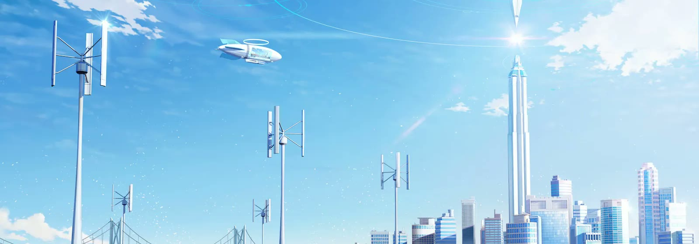
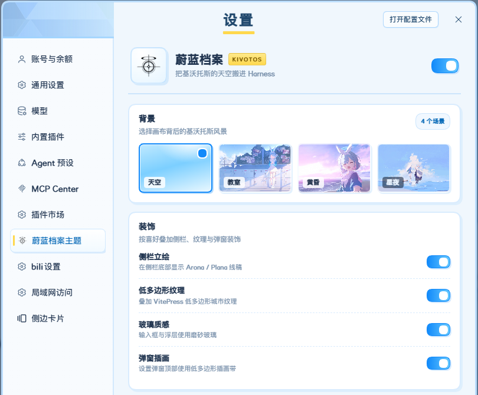
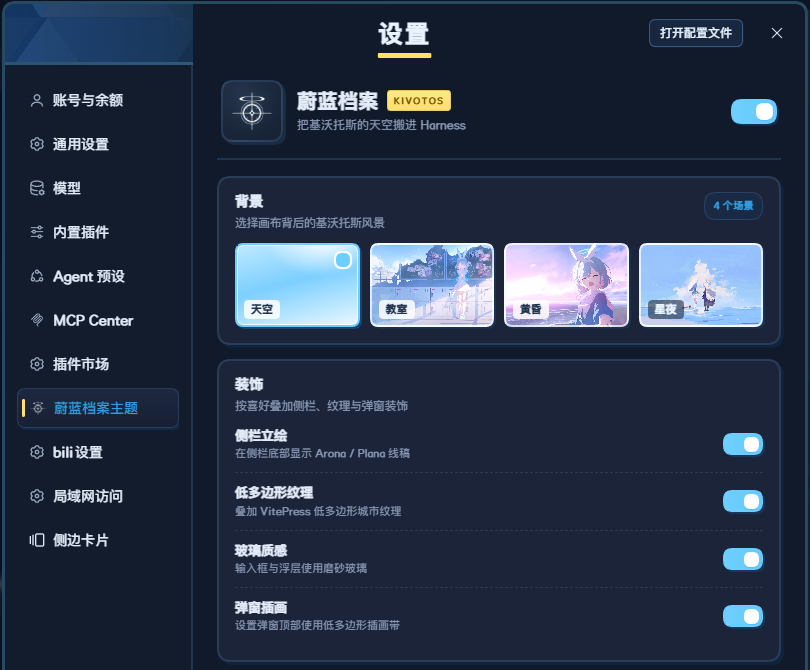

<div align="center">

  

  

</div>

<div align="center">

  [](https://github.com/VanillaNahida/dsh-bluearchive-theme/blob/main/LICENSE)
  [](https://github.com/VanillaNahida/dsh-bluearchive-theme/stargazers)
  [](https://github.com/VanillaNahida/dsh-bluearchive-theme/network)
  [](https://github.com/VanillaNahida/dsh-bluearchive-theme/issues)
  []()
  []()
  []()
  [](https://github.com/VanillaNahida)

</div>

# 蔚蓝档案主题 · Blue Archive Theme for DSH ☁️

把基沃托斯的天空搬进 **DeepSeek Harness**。

> 不是简单的换色：主题同时重写了 `--dsw-*` 颜色令牌、背景层、侧栏立绘、玻璃输入框，以及设置窗口的版式。

# 界面预览

<details open>
<summary>设置页 · 浅色 / 深色</summary>

<div align="center">

  
  <p>浅色：晴空色带 + 低多边形装饰 + 白色卡片</p>

  
  <p>深色：夜间基沃托斯 + 反相 Schale 徽记</p>

</div>
</details>

# 特点 ✨

- ✅ **113 个颜色令牌**：通过 `theme.overrideTokens` 同时提供 light / dark 值，跟随 Harness 官方「外观」设置。
- ✅ **四种背景**：`天空`（默认低多边形晴空）、`教室`、`黄昏`、`星夜`，均为基沃托斯风格插画。
- ✅ **侧栏阿罗娜 / 普拉娜**：底部立绘水印，可单独关闭；窗口变窄时自动隐藏。
- ✅ **低多边形纹理**：VitePress 主题风格的城市纹样，覆盖画布与侧栏，深浅色使用不同透明度。
- ✅ **玻璃质感输入框**：磨砂玻璃 + 蓝色硬边偏移阴影，不再使用黑色模糊阴影。
- ✅ **蔚蓝档案式弹窗**：58px 浅蓝色带、左侧插画、居中标题 + 金色下划线、白色卡片式设置行。
- ✅ **独立设置选项卡**：设置左侧新增「蔚蓝档案主题」，Schale 徽记作为图标，不再挤在「通用设置」列表里。
- ✅ **可选点击特效**：接入 [`ba-click-fx`](https://github.com/CialloKing/ba-click-fx)，开启后全局点击出现光环、碎片与拖尾；单独开关，随时销毁。
- ✅ **自动启用 / 一键关闭**：首次安装自动启用；关闭开关即恢复官方外观，不污染官方主题偏好。

# 安装

## 环境要求

| 项目 | 要求 |
|---|---|
| DeepSeek Harness | `0.2.1-rc.5`（Web GUI） |
| 浏览器 | Chromium / Edge / Firefox 现代版本 |
| 构建 | Node.js 18+（仅开发构建需要） |

## 安装步骤

1. 克隆或下载本仓库：

   ```bash
   git clone https://github.com/VanillaNahida/dsh-bluearchive-theme.git
   ```

2. 在 Harness 的插件安装器（`plugin_manager` / 插件市场）中选择 `dsh-bluearchive-theme` 目录，安装为 **bundle**。

3. 重新加载 Web GUI。首次安装会自动启用；如果没有生效，进入「设置 → 蔚蓝档案主题」手动打开开关。

> [!NOTE]
> 本插件只包含 Web 客户端半部；`lib/index.js` 是为了让 bundle 在 host 侧可解析而存在的空壳，不会注册新的 Cordis 服务。

# 使用

## 打开设置页

进入 **设置 → 蔚蓝档案主题**（左侧导航靠下，位于「插件市场」和「bili设置」之间）。

| 选项 | 说明 |
|---|---|
| 总开关 | 开启 / 关闭整套主题覆盖层 |
| 背景 | 天空 / 教室 / 黄昏 / 星夜 |
| 侧栏立绘 | 侧边栏底部的 Arona / Plana 水印 |
| 低多边形纹理 | 画布与侧栏的城市纹样 |
| 玻璃质感 | 输入框与浮层的磨砂玻璃效果 |
| 弹窗插画 | 设置弹窗顶部的低多边形色带与 Schale 装饰 |

## 明暗模式

浅色 / 深色 / 跟随系统由 Harness 官方的 **设置 → 通用设置 → 外观** 控制。本插件不再提供第二套明暗开关，避免与官方偏好冲突。

## 关闭主题

关闭「蔚蓝档案主题」总开关即可移除令牌覆盖与装饰层，立即回到官方外观；设置会保存在本机，下次打开仍然生效。

# 构建

```bash
node build.mjs
```

`build.mjs` 会把以下内容内联进 `lib/client.js`：

- `src/style.css` → `/*__CSS__*/`
- `src/tokens.json` → `LIGHT` / `DARK` 令牌表
- `assets/` 中的背景、立绘、Schale 徽记、低多边形 SVG、Blueaka 字体 → data URI

构建后检查语法：

```bash
node --check lib/client.js
```

开发时修改 `src/client.js` 或 `src/style.css` 后重新执行 `node build.mjs`，再刷新 Web GUI 即可。

# 项目结构

```
dsh-bluearchive-theme/
├── assets/                  # 背景、立绘、Schale、SVG、Blueaka 字体
│   ├── banner.webp          # README 头图源文件
│   ├── bg-classroom.jpg
│   ├── bg-sunset.jpg
│   ├── bg-twilight.jpg
│   ├── arona.png
│   ├── plana.png
│   ├── card.png
│   ├── schale.png
│   ├── pattern.svg
│   ├── deco2.svg
│   ├── blueaka.woff2
│   ├── blueaka-bold.woff2
│   ├── ba-click-fx.slim.js   # 点击特效运行时（构建时内联）
│   └── ba-click-fx.LICENSE
├── docs/                    # README 预览图
├── locale/
│   ├── en.json              # 插件市场英文文案
│   └── zh.json              # 插件市场中文文案
├── src/
│   ├── client.js            # 浏览器半部（ModuleLoader）
│   ├── style.css            # 主题样式
│   └── tokens.json          # 113 个颜色令牌
├── lib/
│   ├── client.js            # 构建产物（内联 CSS / 令牌 / 素材）
│   └── index.js             # host 侧空壳
├── build.mjs                # 构建脚本
├── cordis.patch.yml         # bundle 插入行
├── package.json
├── README.md
├── PROVENANCE.md
├── THIRD_PARTY_NOTICES.md
└── LICENSE
```

# 实现说明

## 为什么用 `overrideTokens` 而不是注册主题 id

DSH `0.2.1` 只持久化内置的 `light | dark | system` 偏好。注册第三方主题 id 后，虽然能短暂 `setTheme`，但外壳会立刻把偏好收回内置值，导致主题被重置。

因此本插件只做一层**令牌覆盖**：

```js
ctx.theme.overrideTokens(PLUGIN_ID, TOKEN_OVERRIDES)
```

每个令牌提供 `{ light, dark }` 两个值，覆盖层在官方偏好切换时依然保留，也就自然跟随「浅色 / 深色 / 跟随系统」。

## 设置页与图标

设置页通过 `settings.section` 插槽注册：

```js
ctx.slots.register({
  name: 'settings.section',
  id: 'bluearchive-theme',
  order: 95,
  label: () => t('nav'),
  locale: SETTINGS_NS,
}, BlueArchiveSection)
```

设置外壳的导航图标是按 section id 硬编码的，第三方 section 默认得到齿轮。插件用 `MutationObserver` 找到文字为「蔚蓝档案主题」的导航按钮，把齿轮 SVG 替换为 Schale 徽记图片；关闭设置时自动断开观察器。

## 点击特效

「点击特效」开关默认关闭。开启时按需创建一个 `ba-click-fx` 实例，关闭开关、关闭主题或插件卸载时调用 `destroy()`，不会在每次重绘时重复创建。

`ba-click-fx` 发布的是 ESM。`build.mjs` 去掉文件末尾的 `export { ... }`，把类挂到 `globalThis.__baClickFX` 后再拼到 `lib/client.js` 前面，避免动态 `import()` 在严格 CSP 下被拦截。构建时还把上游默认的 `#4ca7ff` 统一替换为蔚蓝档案蓝 `#128afa`。上游为 MIT，版权声明见 [`THIRD_PARTY_NOTICES.md`](THIRD_PARTY_NOTICES.md)。

## 样式作用域

所有装饰规则都挂在 `body[data-ba-theme]` 下，避免影响其他插件（尤其是 `dsh-whale-widget` 的 `dshwv-*` DOM）。选择器尽量使用原生结构片段：

- `[class*="sidebarCol"]`、`[class*="centerCol"]`、`[class*="rightbarCol"]`
- `[data-composer-card]`
- `[data-shortcut-modal="settings"]`
- `[class*="_row"]`、`[class*="_navCell"]`

## 字体

完整 Blueaka 中文字体约 16 MB，不适合内联。插件只内联 Latin / 数字 / 标点的 regular + bold 子集（约 50 KB），中文回退到 `FZLanTingYuan` / `PingFang SC` / `Microsoft YaHei`。

# 常见问题 ❓

### 1、安装后主题没有生效

- 确认「设置 → 蔚蓝档案主题」总开关已打开。
- 重新加载 Web GUI（插件是客户端 bundle，需要刷新页面）。
- 确认 Harness 版本为 `0.2.1-rc.5` 或兼容版本；过旧版本可能没有 `settings.section` 插槽。

### 2、设置左侧没有「蔚蓝档案主题」

先打开一次「设置」，再检查左侧导航；如果仍然没有，说明 bundle 没有成功加载，查看 Harness 的插件日志是否有 `dsh-bluearchive-theme` 相关报错。

### 3、切换浅色 / 深色没有反应

明暗由官方「设置 → 通用设置 → 外观」控制，本插件只跟随，不提供独立开关。切换后如果颜色没有变化，关闭再打开主题总开关即可重新应用令牌层。

### 4、为什么中文不是 Blueaka 字体

Blueaka 的完整中文字体体积过大，插件只内联了 Latin 子集；中文使用系统字体回退，标题、数字和英文仍为 Blueaka。

### 5、背景 / 立绘的版权

角色插画与背景来自 Blue Archive 官方素材，仅限个人、非商业使用。详见 [`PROVENANCE.md`](PROVENANCE.md)。代码部分以 MIT 发布。

# 素材与版权

- **代码**：MIT，见 [`LICENSE`](LICENSE)。
- **Blue Archive 角色与场景**：© NEXON Games / Yostar，仅限个人非商业使用。
- **VitePress 低多边形素材 / Blueaka 字体**：来自 [`vitepress-theme-bluearchive`](https://github.com/Alittfre/vitepress-theme-bluearchive)，按其原许可使用。
- **点击特效**：[`ba-click-fx`](https://github.com/CialloKing/ba-click-fx)，MIT，Copyright (c) 2026 CialloKing；完整许可见 [`THIRD_PARTY_NOTICES.md`](THIRD_PARTY_NOTICES.md)。
- **Schale 徽记**：来自用户提供的 `Schale Logo.png`，裁去下方文字后使用。

# 反馈 🐛

- [GitHub Issues](https://github.com/VanillaNahida/dsh-bluearchive-theme/issues)
- 欢迎提交 PR 补充新的基沃托斯背景、立绘或弹窗样式。

# Star History

<a href="https://www.star-history.com/?repos=VanillaNahida%2Fdsh-bluearchive-theme&type=date&legend=top-left">
 <picture>
   <source media="(prefers-color-scheme: dark)" srcset="https://api.star-history.com/chart?repos=VanillaNahida/dsh-bluearchive-theme&type=date&theme=dark&legend=top-left" />
   <source media="(prefers-color-scheme: light)" srcset="https://api.star-history.com/chart?repos=VanillaNahida/dsh-bluearchive-theme&type=date&legend=top-left" />
   
 </picture>
</a>

<div align="center">

  <sub>Made with ☁️ &amp; 🩵 for Kivotos · 把基沃托斯的天空搬进 Harness</sub>

</div>
